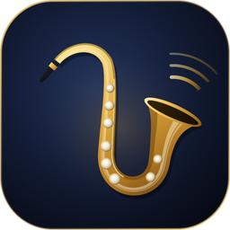
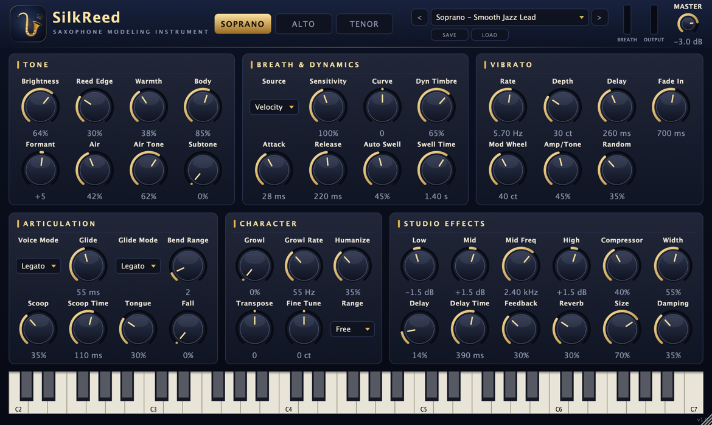

<p align="center">
  <a href="README.md">한국어</a> · <b>English (US)</b> · <a href="README.en-GB.md">English (UK)</a> · <a href="README.zh-CN.md">简体中文</a> · <a href="README.ja.md">日本語</a> · <a href="README.fr.md">Français</a>
</p>

<p align="center">
  
</p>

<h1 align="center">SilkReed Sax</h1>

<p align="center">
  A virtual instrument built only for soprano, alto and tenor saxophone · VST3 / AU / Standalone<br>
  <a href="https://github.com/jayusop/SilkReed-Sax/releases/latest"><b>⬇ Download the latest version</b></a> ·
  <a href="https://jayusop.github.io/SilkReed-Sax/">Website</a>
</p>

<p align="center">
  
  
  
  
  
</p>

<p align="center">
  
</p>

---

**SilkReed Sax** is not a general-purpose sound module that imitates a bit of everything — it's a free macOS virtual instrument designed for **saxophone and nothing else**. Breath and reed buzz, vibrato that blooms after the note, smooth legato, scoops, falls and growl — the expressions sax players actually use — are **modeled in real time, with no samples**. It plays naturally from a keyboard or from an EWI / breath controller.

> Requirements: macOS 12 or later (universal: Apple Silicon / Intel) · a DAW that hosts VST3 or AU, or the standalone app

## Installation

1. Download `SilkReed-Sax-<version>-macOS.zip` from [Releases](https://github.com/jayusop/SilkReed-Sax/releases/latest) and unzip it.
2. Copy the formats your DAW uses (in Finder, <kbd>⌘⇧G</kbd> opens a path).

   | File | Copy to |
   |---|---|
   | `SilkReed Sax.vst3` | `~/Library/Audio/Plug-Ins/VST3` |
   | `SilkReed Sax.component` | `~/Library/Audio/Plug-Ins/Components` (Logic, GarageBand) |
   | `SilkReed Sax.app` | `/Applications` (runs without a DAW) |

3. This is a personal build that isn't notarized by Apple, so macOS may say it is damaged or from an unidentified developer. Clear the flag in Terminal:
   ```bash
xattr -dr com.apple.quarantine ~/Library/Audio/Plug-Ins/VST3/"SilkReed Sax.vst3"
xattr -dr com.apple.quarantine ~/Library/Audio/Plug-Ins/Components/"SilkReed Sax.component"
xattr -dr com.apple.quarantine /Applications/"SilkReed Sax.app"
```
4. Restart or rescan your DAW and insert **SilkReed Sax** on an instrument track. Logic Pro: *Instrument › AU Instruments › SilkReed Audio › SilkReed Sax*

## Features

| Area | What you get |
|---|---|
| Horns | Soprano · Alto · Tenor — each with its own bore, bell and tone-hole profile |
| Tone | 64 phase-locked harmonic oscillators, timbre that brightens as you push, pitch-synchronous breath noise, reed saturation, subtone |
| Expression | Delayed, fading-in lip vibrato, legato slurs and glide, scoops, falls, tonguing, growl, humanize, Auto Swell |
| Controllers | CC2 breath · CC11 expression · aftertouch · mod-wheel vibrato · pitch bend (1–12 semitones) · sustain |
| Effects | 3-band EQ, RMS compressor, stereo early reflections, ping-pong delay, 8-line FDN reverb, safety limiter |
| Other | 14 factory presets + user presets, window size 60–200%, about 0.7% CPU (mono, Apple Silicon) |

## Presets

Soprano: **Smooth Jazz Lead ★** · Silk Ballad · Bright Pop Lead · Intimate Dry · EWI Breath Control  
Alto: Warm Ballad · Smooth R&B Lead · Funk Edge · EWI Breath Control  
Tenor: Breathy Ballad · Smooth Lead · Gritty Rock · EWI Breath Control  
Init (Default)

User presets are saved to `~/Music/SilkReed Sax/Presets/`.

## Source code and building

The complete source code is attached to every release as `SilkReed-Sax-<version>-source.zip`. You need the Xcode command-line tools and CMake 3.22+.

```bash
brew install cmake
./build.sh universal   # Apple Silicon + Intel → build-universal/
./build.sh arm64       # Apple Silicon only
./build.sh x86_64      # Intel only
```

## License

**Free**, distributed under the **GNU AGPL v3 or later**.

- Use it for personal or commercial work; music and audio you make with it are yours.
- If you modify or redistribute the plug-in itself, you must publish the full source and keep it under the AGPLv3.
- Built with JUCE 8.0.9 (AGPLv3) and the Steinberg VST3 SDK 3.7.12 (GPLv3) under their open-source licenses.

Full text: [LICENSE](LICENSE) · [Third-party licenses](docs/THIRD_PARTY_NOTICES.txt)

VST is a registered trademark of Steinberg Media Technologies GmbH; Audio Units and macOS are trademarks of Apple Inc.

## Contact

- Bug reports: [Issues](https://github.com/jayusop/SilkReed-Sax/issues) · email jayusop@gmail.com
