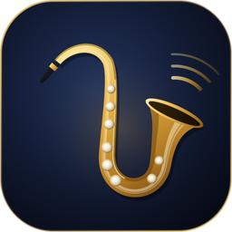
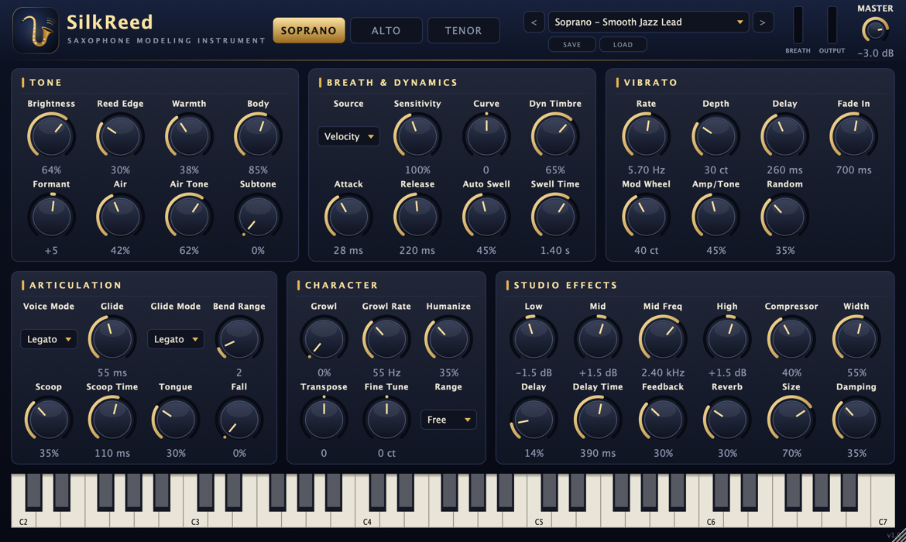

<p align="center">
  <a href="README.md">한국어</a> · <a href="README.en.md">English (US)</a> · <a href="README.en-GB.md">English (UK)</a> · <a href="README.zh-CN.md">简体中文</a> · <a href="README.ja.md">日本語</a> · <b>Français</b>
</p>

<p align="center">
  
</p>

<h1 align="center">SilkReed Sax</h1>

<p align="center">
  Un instrument virtuel conçu uniquement pour le saxophone soprano, alto et ténor · VST3 / AU / Standalone<br>
  <a href="https://github.com/jayusop/SilkReed-Sax/releases/latest"><b>⬇ Télécharger la dernière version</b></a> ·
  <a href="https://jayusop.github.io/SilkReed-Sax/">Site de présentation</a>
</p>

<p align="center">
  
  
  
  
  
</p>

<p align="center">
  
</p>

---

**SilkReed Sax** n'est pas un module de sons généraliste qui imite un peu de tout : c'est un instrument virtuel gratuit pour macOS conçu **pour le saxophone, et rien d'autre**. Le souffle et la vibration de l'anche, un vibrato qui s'épanouit après l'attaque, un legato fluide, les scoops, chutes et growl — les expressions qu'utilisent vraiment les saxophonistes — sont **modélisés en temps réel, sans aucun échantillon**. Il se joue naturellement au clavier comme avec un EWI ou un contrôleur de souffle.

> Configuration requise : macOS 12 ou ultérieur (universel : Apple Silicon / Intel) · une STAN compatible VST3 ou AU, ou l'application autonome

## Installation

1. Téléchargez `SilkReed-Sax-<version>-macOS.zip` depuis [Releases](https://github.com/jayusop/SilkReed-Sax/releases/latest) et décompressez-le.
2. Copiez les formats utilisés par votre STAN (dans le Finder, <kbd>⌘⇧G</kbd> ouvre un chemin).

   | Fichier | Copier dans |
   |---|---|
   | `SilkReed Sax.vst3` | `~/Library/Audio/Plug-Ins/VST3` |
   | `SilkReed Sax.component` | `~/Library/Audio/Plug-Ins/Components` (Logic, GarageBand) |
   | `SilkReed Sax.app` | `/Applications` (fonctionne sans STAN) |

3. Cette version personnelle n'est pas notariée par Apple : macOS peut indiquer qu'elle est endommagée ou provient d'un développeur non identifié. Levez la quarantaine dans le Terminal :
   ```bash
xattr -dr com.apple.quarantine ~/Library/Audio/Plug-Ins/VST3/"SilkReed Sax.vst3"
xattr -dr com.apple.quarantine ~/Library/Audio/Plug-Ins/Components/"SilkReed Sax.component"
xattr -dr com.apple.quarantine /Applications/"SilkReed Sax.app"
```
4. Redémarrez votre STAN ou relancez l'analyse des plug-ins, puis chargez **SilkReed Sax** sur une piste d'instrument. Logic Pro : *Instrument › AU Instruments › SilkReed Audio › SilkReed Sax*

## Fonctionnalités

| Domaine | Contenu |
|---|---|
| Instruments | Soprano · Alto · Ténor — chacun avec ses propres résonances de perce, de pavillon et de trous de clé |
| Timbre | 64 oscillateurs harmoniques à phase verrouillée, timbre qui s'éclaircit quand on souffle plus fort, bruit de souffle synchronisé sur la hauteur, saturation d'anche, subtone |
| Expression | Vibrato de lèvres avec retard et fondu, liaisons legato et glissando, scoops, chutes, coup de langue, growl, humanisation, Auto Swell |
| Contrôleurs | Souffle CC2 · expression CC11 · aftertouch · vibrato à la molette de modulation · pitch bend (1–12 demi-tons) · sustain |
| Effets | EQ 3 bandes, compresseur RMS, premières réflexions stéréo, délai ping-pong, réverbération FDN à 8 lignes, limiteur de sécurité |
| Divers | 14 presets d'usine + presets utilisateur, taille de fenêtre 60–200 %, environ 0,7 % de CPU (mono, Apple Silicon) |

## Presets

Soprano: **Smooth Jazz Lead ★** · Silk Ballad · Bright Pop Lead · Intimate Dry · EWI Breath Control  
Alto: Warm Ballad · Smooth R&B Lead · Funk Edge · EWI Breath Control  
Tenor: Breathy Ballad · Smooth Lead · Gritty Rock · EWI Breath Control  
Init (Default)

Les presets utilisateur sont enregistrés dans `~/Music/SilkReed Sax/Presets/`.

## Code source et compilation

Le code source complet est joint à chaque version sous le nom `SilkReed-Sax-<version>-source.zip`. Il faut les outils en ligne de commande de Xcode et CMake 3.22 ou ultérieur.

```bash
brew install cmake
./build.sh universal   # Apple Silicon + Intel → build-universal/
./build.sh arm64       # Apple Silicon only
./build.sh x86_64      # Intel only
```

## Licence

**Gratuit**, distribué sous **GNU AGPL v3 ou ultérieure**.

- Utilisation libre pour des projets personnels ou commerciaux ; la musique et l'audio que vous créez avec vous appartiennent.
- Si vous modifiez ou redistribuez le plug-in lui-même, vous devez publier le code source complet et conserver l'AGPLv3.
- Utilise JUCE 8.0.9 (AGPLv3) et le SDK VST3 de Steinberg 3.7.12 (GPLv3) sous leurs licences open source.

Texte intégral : [LICENSE](LICENSE) (original anglais) · [Licences tierces](docs/THIRD_PARTY_NOTICES.txt)

VST est une marque déposée de Steinberg Media Technologies GmbH ; Audio Units et macOS sont des marques d'Apple Inc.

## Contact

- Signaler un bug : [Issues](https://github.com/jayusop/SilkReed-Sax/issues) · e-mail jayusop@gmail.com
