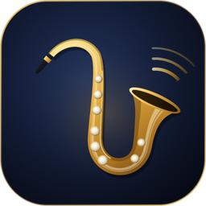
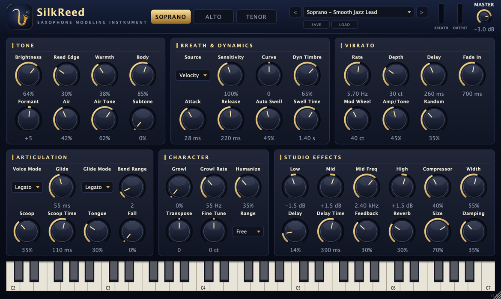

<p align="center">
  <a href="README.md">한국어</a> · <a href="README.en.md">English (US)</a> · <a href="README.en-GB.md">English (UK)</a> · <a href="README.zh-CN.md">简体中文</a> · <b>日本語</b> · <a href="README.fr.md">Français</a>
</p>

<p align="center">
  
</p>

<h1 align="center">SilkReed Sax</h1>

<p align="center">
  ソプラノ・アルト・テナーサックスのためだけに作られた仮想楽器 · VST3 / AU / Standalone<br>
  <a href="https://github.com/jayusop/SilkReed-Sax/releases/latest"><b>⬇ 最新版をダウンロード</b></a> ·
  <a href="https://jayusop.github.io/SilkReed-Sax/">紹介ページ</a>
</p>

<p align="center">
  
  
  
  
  
</p>

<p align="center">
  
</p>

---

**SilkReed Sax** は、あらゆる楽器を少しずつ真似る汎用音源ではなく、**サックスのためだけに**設計された無料の macOS 仮想楽器です。息とリードの震え、音の立ち上がりから少し遅れて広がるビブラート、なめらかなレガート、スクープ・フォール・グロウルまで、サックス奏者が実際に使う表現を**サンプルを使わずリアルタイムでモデリング**します。鍵盤でも EWI・ブレスコントローラーでも自然に演奏できます。

> 動作環境：macOS 12 以降（ユニバーサル：Apple Silicon / Intel）· VST3 または AU に対応した DAW、またはスタンドアロンアプリ

## インストール

1. [Releases](https://github.com/jayusop/SilkReed-Sax/releases/latest) から `SilkReed-Sax-<バージョン>-macOS.zip` をダウンロードして展開します。
2. お使いの DAW に合ったファイルをコピーします（Finder で <kbd>⌘⇧G</kbd> を押すとパスを開けます）。

   | ファイル | コピー先 |
   |---|---|
   | `SilkReed Sax.vst3` | `~/Library/Audio/Plug-Ins/VST3` |
   | `SilkReed Sax.component` | `~/Library/Audio/Plug-Ins/Components`（Logic、GarageBand） |
   | `SilkReed Sax.app` | `/Applications`（DAW なしで単体起動） |

3. Apple の公証を受けていない個人配布版のため、macOS が「壊れている」「開発元を確認できない」と表示することがあります。ターミナルで解除してください：
   ```bash
xattr -dr com.apple.quarantine ~/Library/Audio/Plug-Ins/VST3/"SilkReed Sax.vst3"
xattr -dr com.apple.quarantine ~/Library/Audio/Plug-Ins/Components/"SilkReed Sax.component"
xattr -dr com.apple.quarantine /Applications/"SilkReed Sax.app"
```
4. DAW を再起動するかプラグインを再スキャンし、インストゥルメントトラックに **SilkReed Sax** を読み込みます。Logic Pro：*Instrument › AU Instruments › SilkReed Audio › SilkReed Sax*

## 機能

| 分野 | 内容 |
|---|---|
| 楽器 | ソプラノ · アルト · テナー —— 楽器ごとに異なるボア・ベル・トーンホールの共鳴プロファイル |
| トーン | 位相固定の倍音オシレーター 64 基、強く吹くほど明るくなる音色、ピッチ同期のブレスノイズ、リードサチュレーション、サブトーン |
| 表現 | ディレイ・フェードイン付きのリップビブラート、レガートスラー・グライド、スクープ、フォール、タンギング、グロウル、ヒューマナイズ、Auto Swell |
| コントローラー | CC2 ブレス · CC11 エクスプレッション · アフタータッチ · モジュレーションホイールのビブラート · ピッチベンド（1–12 半音）· サステイン |
| エフェクト | 3 バンド EQ、RMS コンプレッサー、ステレオ初期反射、ピンポンディレイ、8 ライン FDN リバーブ、セーフティリミッター |
| その他 | ファクトリープリセット 14 種 + ユーザープリセット、ウィンドウサイズ 60–200%、CPU 約 0.7%（モノ、Apple Silicon） |

## プリセット

Soprano: **Smooth Jazz Lead ★** · Silk Ballad · Bright Pop Lead · Intimate Dry · EWI Breath Control  
Alto: Warm Ballad · Smooth R&B Lead · Funk Edge · EWI Breath Control  
Tenor: Breathy Ballad · Smooth Lead · Gritty Rock · EWI Breath Control  
Init (Default)

ユーザープリセットは `~/Music/SilkReed Sax/Presets/` に保存されます。

## ソースコードとビルド

完全なソースコードは各リリースに `SilkReed-Sax-<バージョン>-source.zip` として添付されます。Xcode コマンドラインツールと CMake 3.22 以降が必要です。

```bash
brew install cmake
./build.sh universal   # Apple Silicon + Intel → build-universal/
./build.sh arm64       # Apple Silicon only
./build.sh x86_64      # Intel only
```

## ライセンス

**無料**で、**GNU AGPL v3 以降**のもとで配布されます。

- 個人・商用を問わず自由に使えます。このプラグインで作った音楽やオーディオは作った人のものです。
- プラグイン自体を改変・再配布する場合は、完全なソースコードを公開し AGPLv3 を維持する必要があります。
- JUCE 8.0.9（AGPLv3）と Steinberg VST3 SDK 3.7.12（GPLv3）をオープンソースライセンスで使用しています。

全文：[LICENSE](LICENSE)（英語原文）· [サードパーティライセンス](docs/THIRD_PARTY_NOTICES.txt)

VST は Steinberg Media Technologies GmbH の登録商標、Audio Units と macOS は Apple Inc. の商標です。

## お問い合わせ

- 不具合報告：[Issues](https://github.com/jayusop/SilkReed-Sax/issues) · メール jayusop@gmail.com
