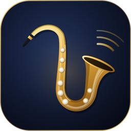
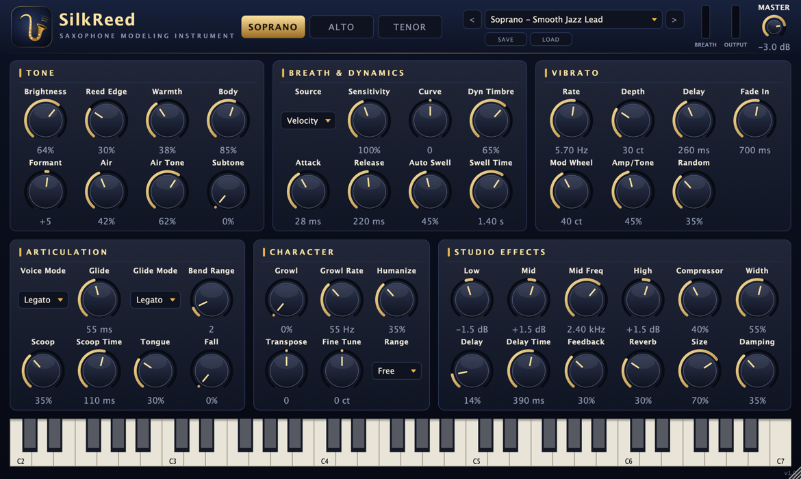

<p align="center">
  <b>한국어</b> · <a href="README.en.md">English (US)</a> · <a href="README.en-GB.md">English (UK)</a> · <a href="README.zh-CN.md">简体中文</a> · <a href="README.ja.md">日本語</a> · <a href="README.fr.md">Français</a>
</p>

<p align="center">
  
</p>

<h1 align="center">SilkReed Sax</h1>

<p align="center">
  소프라노·알토·테너 색소폰만을 위해 만든 가상악기 · VST3 / AU / Standalone<br>
  <a href="https://github.com/jayusop/SilkReed-Sax/releases/latest"><b>⬇ 최신 버전 다운로드</b></a> ·
  <a href="https://jayusop.github.io/SilkReed-Sax/">소개 페이지</a>
</p>

<p align="center">
  
  
  
  
  
</p>

<p align="center">
  
</p>

---

**SilkReed Sax**는 여러 악기를 조금씩 흉내 내는 범용 음원이 아니라, **색소폰 하나만을 위해** 설계한 무료 macOS 가상악기입니다. 숨결과 리드의 떨림, 늦게 피어나는 비브라토, 매끄러운 레가토, 스쿱·폴·그로울까지 색소폰 연주자가 실제로 쓰는 표현을 **샘플 없이 실시간으로 모델링**합니다. 건반으로도, EWI·브레스 컨트롤러로도 자연스럽게 연주됩니다.

> 요구 사항: macOS 12 이상 (Apple Silicon / Intel 유니버설) · VST3 또는 AU를 지원하는 DAW, 또는 단독 실행 앱

## 설치

1. [Releases](https://github.com/jayusop/SilkReed-Sax/releases/latest)에서 `SilkReed-Sax-<버전>-macOS.zip`을 내려받아 압축을 풉니다.
2. 쓰는 DAW에 맞는 파일을 복사합니다 (Finder에서 <kbd>⌘⇧G</kbd>로 경로 열기).

   | 파일 | 복사할 위치 |
   |---|---|
   | `SilkReed Sax.vst3` | `~/Library/Audio/Plug-Ins/VST3` |
   | `SilkReed Sax.component` | `~/Library/Audio/Plug-Ins/Components` (Logic, GarageBand) |
   | `SilkReed Sax.app` | `/Applications` (DAW 없이 단독 실행) |

3. Apple 공증을 받지 않은 개인 배포판이라 macOS가 "손상되었거나 확인할 수 없는 개발자" 경고를 띄울 수 있습니다. 터미널에서 해제하세요.
   ```bash
xattr -dr com.apple.quarantine ~/Library/Audio/Plug-Ins/VST3/"SilkReed Sax.vst3"
xattr -dr com.apple.quarantine ~/Library/Audio/Plug-Ins/Components/"SilkReed Sax.component"
xattr -dr com.apple.quarantine /Applications/"SilkReed Sax.app"
```
4. DAW를 다시 시작하거나 플러그인을 다시 스캔한 뒤 악기 트랙에 **SilkReed Sax**를 올립니다. Logic Pro: *Instrument › AU Instruments › SilkReed Audio › SilkReed Sax*

## 기능

| 영역 | 기능 |
|---|---|
| 악기 | 소프라노 · 알토 · 테너 — 악기마다 다른 보어·벨 공명과 톤홀 프로파일 |
| 톤 | 위상 고정 배음 오실레이터 64개, 세게 불수록 밝아지는 다이내믹 음색, 피치 동기 숨결 노이즈, 리드 새츄레이션, 서브톤 |
| 표현 | 딜레이·페이드인 립 비브라토, 레가토 슬러·글라이드, 스쿱, 폴, 텅잉, 그로울, 휴머나이즈, Auto Swell |
| 컨트롤러 | CC2 브레스 · CC11 익스프레션 · 애프터터치 · 모드 휠 비브라토 · 피치 벤드(1–12반음) · 서스테인 |
| 이펙트 | 3밴드 EQ, RMS 컴프레서, 스테레오 초기 반사, 핑퐁 딜레이, 8라인 FDN 리버브, 안전 리미터 |
| 기타 | 팩토리 프리셋 14개 + 사용자 프리셋, 창 크기 60–200%, CPU 약 0.7%(모노, Apple Silicon) |

## 프리셋

Soprano: **Smooth Jazz Lead ★** · Silk Ballad · Bright Pop Lead · Intimate Dry · EWI Breath Control  
Alto: Warm Ballad · Smooth R&B Lead · Funk Edge · EWI Breath Control  
Tenor: Breathy Ballad · Smooth Lead · Gritty Rock · EWI Breath Control  
Init (Default)

사용자 프리셋은 `~/Music/SilkReed Sax/Presets/`에 저장됩니다.

## 소스 코드와 빌드

전체 소스 코드는 각 릴리스에 `SilkReed-Sax-<버전>-source.zip`으로 함께 올라갑니다. Xcode 커맨드라인 툴과 CMake 3.22 이상이 필요합니다.

```bash
brew install cmake
./build.sh universal   # Apple Silicon + Intel → build-universal/
./build.sh arm64       # Apple Silicon only
./build.sh x86_64      # Intel only
```

## 라이선스

**무료**이며 **GNU AGPL v3 이상**으로 배포됩니다.

- 개인·상업 작업 모두 자유롭게 쓸 수 있고, 이 플러그인으로 만든 음악과 오디오는 만든 사람의 것입니다.
- 플러그인 자체를 수정하거나 재배포할 때는 전체 소스를 함께 공개하고 AGPLv3를 유지해야 합니다.
- JUCE 8.0.9(AGPLv3)와 Steinberg VST3 SDK 3.7.12(GPLv3)를 오픈소스 라이선스로 사용합니다.

전문: [LICENSE](LICENSE) (영어 원문) · [LICENSE.ko.md](LICENSE.ko.md) (한국어 안내) · [제3자 라이선스](docs/THIRD_PARTY_NOTICES.txt)

VST는 Steinberg Media Technologies GmbH의 등록 상표, Audio Units와 macOS는 Apple Inc.의 상표입니다.

## 문의

- 버그 신고: [Issues](https://github.com/jayusop/SilkReed-Sax/issues) · 메일 jayusop@gmail.com
