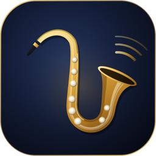
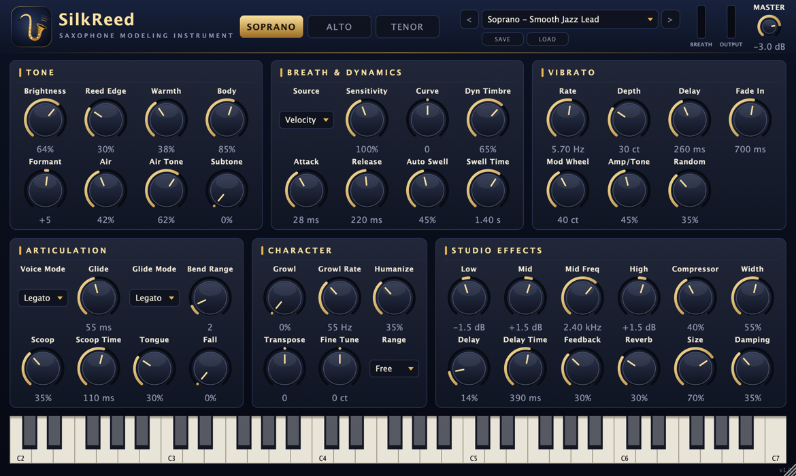

<p align="center">
  <a href="README.md">한국어</a> · <a href="README.en.md">English (US)</a> · <a href="README.en-GB.md">English (UK)</a> · <b>简体中文</b> · <a href="README.ja.md">日本語</a> · <a href="README.fr.md">Français</a>
</p>

<p align="center">
  
</p>

<h1 align="center">SilkReed Sax</h1>

<p align="center">
  专为高音、中音、次中音萨克斯打造的虚拟乐器 · VST3 / AU / Standalone<br>
  <a href="https://github.com/jayusop/SilkReed-Sax/releases/latest"><b>⬇ 下载最新版本</b></a> ·
  <a href="https://jayusop.github.io/SilkReed-Sax/">介绍页面</a>
</p>

<p align="center">
  
  
  
  
  
</p>

<p align="center">
  
</p>

---

**SilkReed Sax** 不是什么都模仿一点的通用音源，而是一款**只为萨克斯**设计的免费 macOS 虚拟乐器。气息与簧片的震动、在音头之后缓缓展开的颤音、顺滑的连奏、上滑音、下滑音和咆哮音——萨克斯演奏者真正使用的这些表现手法都**不依赖采样，实时建模合成**。无论用键盘还是 EWI / 气息控制器都能自然演奏。

> 系统要求：macOS 12 或更高版本（通用二进制：Apple Silicon / Intel）· 支持 VST3 或 AU 的 DAW，或独立运行程序

## 安装

1. 从 [Releases](https://github.com/jayusop/SilkReed-Sax/releases/latest) 下载 `SilkReed-Sax-<版本>-macOS.zip` 并解压。
2. 复制你的 DAW 所需的格式（在访达中按 <kbd>⌘⇧G</kbd> 可前往路径）。

   | 文件 | 复制到 |
   |---|---|
   | `SilkReed Sax.vst3` | `~/Library/Audio/Plug-Ins/VST3` |
   | `SilkReed Sax.component` | `~/Library/Audio/Plug-Ins/Components`（Logic、GarageBand） |
   | `SilkReed Sax.app` | `/Applications`（无需 DAW 即可运行） |

3. 这是未经 Apple 公证的个人发布版本，macOS 可能提示"已损坏"或"无法验证开发者"。请在终端中解除隔离：
   ```bash
xattr -dr com.apple.quarantine ~/Library/Audio/Plug-Ins/VST3/"SilkReed Sax.vst3"
xattr -dr com.apple.quarantine ~/Library/Audio/Plug-Ins/Components/"SilkReed Sax.component"
xattr -dr com.apple.quarantine /Applications/"SilkReed Sax.app"
```
4. 重启 DAW 或重新扫描插件，然后在乐器轨道上加载 **SilkReed Sax**。Logic Pro：*Instrument › AU Instruments › SilkReed Audio › SilkReed Sax*

## 功能

| 类别 | 内容 |
|---|---|
| 乐器 | 高音 · 中音 · 次中音 —— 各自独立的管体、喇叭口与音孔共鸣模型 |
| 音色 | 64 个相位锁定谐波振荡器，吹得越强音色越亮，音高同步气息噪声，簧片饱和，Subtone |
| 表现 | 延迟渐入的唇颤音、连奏与滑音、上滑音、下滑音、吐音、咆哮音、人性化、Auto Swell |
| 控制器 | CC2 气息 · CC11 表情 · 触后 · 调制轮颤音 · 弯音（1–12 半音）· 延音踏板 |
| 效果器 | 三段均衡、RMS 压缩器、立体声早期反射、乒乓延迟、8 线 FDN 混响、安全限幅器 |
| 其他 | 14 个出厂预置 + 用户预置，窗口缩放 60–200%，CPU 约 0.7%（单音，Apple Silicon） |

## 预置

Soprano: **Smooth Jazz Lead ★** · Silk Ballad · Bright Pop Lead · Intimate Dry · EWI Breath Control  
Alto: Warm Ballad · Smooth R&B Lead · Funk Edge · EWI Breath Control  
Tenor: Breathy Ballad · Smooth Lead · Gritty Rock · EWI Breath Control  
Init (Default)

用户预置保存在 `~/Music/SilkReed Sax/Presets/`。

## 源代码与构建

每个版本都会附带完整源代码 `SilkReed-Sax-<版本>-source.zip`。需要 Xcode 命令行工具和 CMake 3.22 或更高版本。

```bash
brew install cmake
./build.sh universal   # Apple Silicon + Intel → build-universal/
./build.sh arm64       # Apple Silicon only
./build.sh x86_64      # Intel only
```

## 许可证

**免费**，以 **GNU AGPL v3 或更高版本**发布。

- 可用于个人和商业创作；用它制作的音乐和音频归你所有。
- 修改或再分发插件本身时，必须公开完整源代码并保持 AGPLv3 许可。
- 以开源许可使用 JUCE 8.0.9（AGPLv3）和 Steinberg VST3 SDK 3.7.12（GPLv3）。

全文：[LICENSE](LICENSE)（英文原文）· [第三方许可证](docs/THIRD_PARTY_NOTICES.txt)

VST 是 Steinberg Media Technologies GmbH 的注册商标；Audio Units 和 macOS 是 Apple Inc. 的商标。

## 联系

- 问题反馈：[Issues](https://github.com/jayusop/SilkReed-Sax/issues) · 邮件 jayusop@gmail.com
